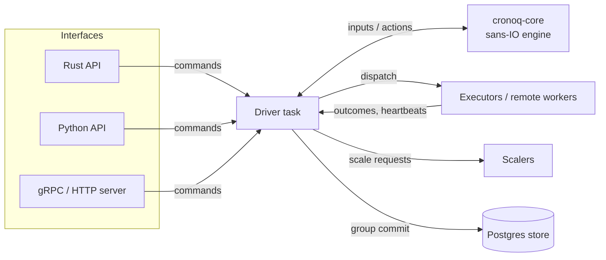

<h1 align="center">cronoq</h1>

<p align="center">
  <strong>An elastic, priority-aware task scheduler for Rust, Python and any language over gRPC.</strong><br>
  Priorities with aging · deadlines · cron with reserved capacity · DAGs · rate limits · queue-pressure autoscaling · Postgres HA
</p>

<p align="center">
  <a href="https://github.com/synaptiai/cronoq/actions/workflows/ci.yml"></a>
  <a href="https://crates.io/crates/cronoq"></a>
  <a href="https://docs.rs/cronoq"></a>
  <a href="https://pypi.org/project/cronoq/"></a>
  
  <a href="#license"></a>
</p>

<p align="center">
  <a href="https://synaptiai.github.io/cronoq/">Documentation</a> ·
  <a href="https://synaptiai.github.io/cronoq/use-cases/index.html">Use cases</a> ·
  <a href="#quickstart">Quickstart</a> ·
  <a href="CONTRIBUTING.md">Contributing</a>
</p>

---

cronoq decides **when** work runs, **in what order**, and **how much capacity** it needs. You
decide **where** it runs: async functions in your process, Python coroutines, or remote workers
connected over gRPC. One engine powers all three, with the same rules, configuration and metrics.

## Why cronoq

Plain queues treat every job the same. Real workloads do not:

- 🧑‍💻 **User-facing work stuck behind batch jobs** → four priority classes; dispatch always
  takes the most urgent ready task, and aging stops background work from starving.
- ⏰ **SLAs missed with idle capacity earlier in the day** → deadlines raise urgency as the
  latest start time approaches; earliest-deadline-first within a class.
- 📅 **Cron jobs starting late because workers were busy** → fixed-start tasks reserve capacity
  when submitted and get a worker *held* just before they start.
- 🚦 **429 storms against rate-limited APIs** → shared token buckets and semaphores are enforced
  before dispatch; tasks waiting for a limit don't occupy a worker; `retry_after` is honoured.
- 💸 **Paying for idle workers at night, saturated at noon** → queue-pressure autoscaling per
  pool, pre-warmed for upcoming reservations, with cost reporting.
- 🔗 **Hand-rolled job chaining** → DAG edges on success, failure or completion; atomic batches;
  idempotent keys.
- 💥 **Lost jobs when a worker dies** → leases, heartbeats, timeouts, retries with backoff,
  dead letters, and Postgres-backed failover.

It is fast enough for the hot path: **~1 million scheduling decisions per second per core**, with
dispatch cost independent of backlog size.

Not sure it fits your system? [Benefits at a glance](https://synaptiai.github.io/cronoq/benefits.html)
maps common symptoms to features, shows where to start, and lists the trade-offs.

## Quickstart

### Rust

```toml
[dependencies]
cronoq = "0.1"
tokio = { version = "1", features = ["macros", "rt-multi-thread"] }
```

```rust
use std::{sync::Arc, time::Duration};
use cronoq::{Pool, Priority, ResourceConfig, Scheduler, Task, TaskError};

#[tokio::main]
async fn main() -> Result<(), Box<dyn std::error::Error>> {
    let sched = Scheduler::<String, usize>::builder()
        .resource(ResourceConfig::token_bucket("llm-api", 20.0, 5)) // 20 req/s, burst 5
        .pool(Pool::new("agents").workers(1, 2, 32).executor_fn(|_ctx, prompt: Arc<String>| async move {
            // call a model; return Err(TaskError::retry_after("429", d)) to back off
            Ok::<_, TaskError>(prompt.len())
        }))
        .build()
        .await?;

    let handle = sched
        .submit(Task::new("hello".to_string())
            .pool("agents")
            .priority(Priority::High)
            .deadline_in(Duration::from_secs(5))
            .resource("llm-api", 1))
        .await?;
    println!("{}", handle.await?);

    sched.shutdown(Duration::from_secs(5)).await?;
    Ok(())
}
```

### Python

```sh
pip install cronoq
```

```python
import asyncio, cronoq

async def summarize(ctx, text):
    return text[:20]

async def main():
    async with cronoq.Scheduler([cronoq.Pool("default", summarize, min=1, max=8)]) as sched:
        handle = await sched.submit("a long document ...", priority="high", deadline_in=5.0)
        print(await handle)

asyncio.run(main())
```

### Server with remote workers

```sh
# One random token per role (at least 16 characters; 32+ recommended).
for role in CLIENT WORKER METRICS ADMIN; do export CRONOQ_${role}_TOKEN=$(openssl rand -hex 24); done
docker build -t cronoq . && docker run -p 7070:7070 -p 7071:7071 \
  -e CRONOQ_CLIENT_TOKEN -e CRONOQ_WORKER_TOKEN -e CRONOQ_METRICS_TOKEN -e CRONOQ_ADMIN_TOKEN cronoq
```

A worker (Python, `pip install "cronoq[client]"`):

```python
import os
from cronoq.client import Worker

async def handle(lease):
    return {"echo": lease.json()}

await Worker("localhost:7070", "default", handle, slots=4,
             token=os.environ["CRONOQ_WORKER_TOKEN"]).run()
```

Submit from anywhere:

```sh
curl -X POST localhost:7071/v1/tasks -H "authorization: Bearer $CRONOQ_CLIENT_TOKEN" \
     -H 'content-type: application/json' \
     -d '{"payload": {"hello": "world"}, "priority": "high", "wait": true}'
```

## Use cases

| | |
|---|---|
| [LLM and agent workloads](https://synaptiai.github.io/cronoq/use-cases/llm-agents.html) | Rate limits, 429 backoff, chat before batch, autoscaling |
| [Interactive + batch on shared capacity](https://synaptiai.github.io/cronoq/use-cases/priority-mixing.html) | One fleet instead of two, no starvation |
| [Deadline-driven work](https://synaptiai.github.io/cronoq/use-cases/deadlines.html) | Reorder by urgency to meet SLAs |
| [Scheduled jobs with guaranteed capacity](https://synaptiai.github.io/cronoq/use-cases/scheduled-jobs.html) | Cron that starts on time |
| [Pipelines and DAGs](https://synaptiai.github.io/cronoq/use-cases/pipelines.html) | Fan-out/fan-in, failure handlers, atomic batches |
| [GPUs and scarce resources](https://synaptiai.github.io/cronoq/use-cases/scarce-resources.html) | Global semaphores, no head-of-line blocking |
| [High-throughput microtasks](https://synaptiai.github.io/cronoq/use-cases/microtasks.html) | Microsecond scheduling overhead |
| [Polyglot worker fleets](https://synaptiai.github.io/cronoq/use-cases/worker-fleets.html) | gRPC workers in any language, HA |
| [Cost-aware autoscaling](https://synaptiai.github.io/cronoq/use-cases/autoscaling.html) | Queue-pressure scaling, KEDA integration |

## Features

| Area | Highlights |
|---|---|
| Ordering | 4 priority classes, aging, FIFO within class, deadline urgency, EDF |
| Time | Fixed starts with reservations and worker holds, miss policies, cron with time zones |
| Dependencies | DAG edges by id or key, `on_success` / `on_failure` / `on_complete`, atomic batches, dedup keys |
| Reliability | Leases, heartbeats, timeouts, retries with exponential backoff and `retry_after`, dead letters, cancellation |
| Limits | Semaphores and token buckets shared across pools, bounded queues (wait / reject / shed) |
| Elasticity | Per-pool queue-pressure autoscaling, wait-time SLOs, reservation pre-warming, cost reporting |
| Durability | Postgres store, leader election, epoch fencing, recovery, at-least-once execution |
| Interfaces | Rust (async + blocking), Python (asyncio), gRPC, HTTP/JSON |
| Observability | OpenTelemetry metrics and trace propagation, Prometheus, windowed quality metrics |

## Performance

| | Measured on a shared 4-vCPU VM |
|---|---|
| Engine: submit → dispatch → complete | ~1.0–1.2 million cycles/s per core |
| End to end through tokio, no-op tasks | ~250,000 tasks/s |
| Sequential submit → await round trip | ~70 µs |

CI gates on these numbers (`cargo bench -p cronoq-core`, `cargo bench -p cronoq`).

## Architecture



The engine is a deterministic state machine with no clock or I/O, tested by randomized
simulation under virtual time. Details: [Architecture](https://synaptiai.github.io/cronoq/architecture.html).

## Documentation

- 📘 **Book**: [synaptiai.github.io/cronoq](https://synaptiai.github.io/cronoq/) (source in
  [`docs/book`](docs/book)): concepts, use cases, guides and reference.
- 🎯 **Benefits and decision guide**: [Benefits at a glance](https://synaptiai.github.io/cronoq/benefits.html)
- ⚙️ **Server**: [configuration](https://synaptiai.github.io/cronoq/reference/configuration.html),
  [HTTP API](https://synaptiai.github.io/cronoq/reference/http.html),
  [security hardening](https://synaptiai.github.io/cronoq/guides/security.html)
- 🦀 **Rust API**: [docs.rs/cronoq](https://docs.rs/cronoq)
- 🐍 **Python**: [`crates/cronoq-py`](crates/cronoq-py/README.md)
- 🔌 **gRPC API**: [`cronoq.proto`](crates/cronoq-proto/proto/cronoq/v1/cronoq.proto)
- 📐 **Design document**: [`docs/SPEC.md`](docs/SPEC.md)

## Repository layout

| Crate | Description |
|---|---|
| [`cronoq-core`](crates/cronoq-core) | Sans-IO scheduling engine |
| [`cronoq`](crates/cronoq) | Tokio runtime and Rust API |
| [`cronoq-store-postgres`](crates/cronoq-store-postgres) | Durable store with leader election and fencing |
| [`cronoq-proto`](crates/cronoq-proto) | Protobuf definitions and generated gRPC code |
| [`cronoq-server`](crates/cronoq-server) | gRPC/HTTP server, remote workers, Rust worker client |
| [`cronoq-py`](crates/cronoq-py) | Python bindings and gRPC client |

## Community

- Questions and ideas: [GitHub Discussions](https://github.com/synaptiai/cronoq/discussions)
- Bugs and feature requests: [GitHub Issues](https://github.com/synaptiai/cronoq/issues)
- Contributing: see [CONTRIBUTING.md](CONTRIBUTING.md) and the [Code of Conduct](CODE_OF_CONDUCT.md)
- Security: see [SECURITY.md](SECURITY.md); please report vulnerabilities privately
- Changes: [CHANGELOG.md](CHANGELOG.md)

## License

Licensed under either of

- Apache License, Version 2.0 ([LICENSE-APACHE](LICENSE-APACHE))
- MIT license ([LICENSE-MIT](LICENSE-MIT))

at your option. Unless you explicitly state otherwise, any contribution intentionally submitted
for inclusion in the work by you, as defined in the Apache-2.0 license, shall be dual licensed as
above, without any additional terms or conditions.
