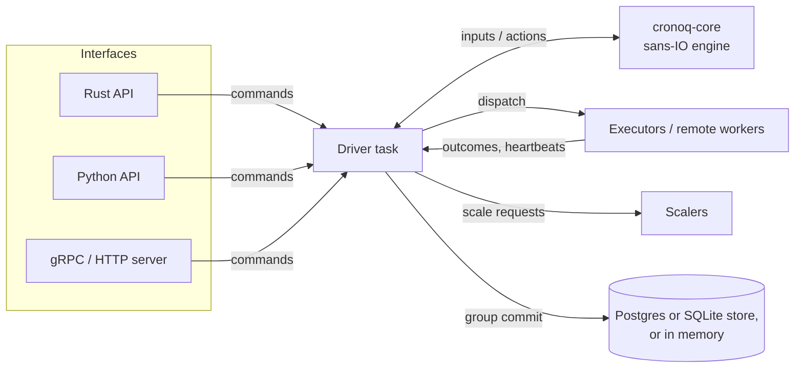

<h1 align="center">cronoq</h1>

<p align="center">
  <strong>An elastic, priority-aware task scheduler for Rust, Python and any language over gRPC.</strong><br>
  Priorities with aging · deadlines · cron with reserved capacity · DAGs · rate limits · queue-pressure autoscaling · Postgres or SQLite HA
</p>

<p align="center">
  <a href="https://github.com/synaptiai/cronoq/actions/workflows/ci.yml"></a>
  <a href="https://crates.io/crates/cronoq"></a>
  <a href="https://docs.rs/cronoq"></a>
  <a href="https://pypi.org/project/cronoq/"></a>
  
  <a href="#license"></a>
</p>

<p align="center">
  <a href="https://synaptiai.github.io/cronoq/">Documentation</a> ·
  <a href="https://synaptiai.github.io/cronoq/use-cases/index.html">Use cases</a> ·
  <a href="#quickstart">Quickstart</a> ·
  <a href="CONTRIBUTING.md">Contributing</a>
</p>

---

cronoq decides **when** work runs, **in what order**, and **how much capacity** it needs. You
decide **where** it runs: async functions in your process, Python coroutines, or remote workers
connected over gRPC. One engine powers all three, with the same scheduling rules and metrics.

## Why cronoq

Plain queues treat every job the same. Real workloads do not:

- 🧑‍💻 **User-facing work stuck behind batch jobs** → four priority classes, so urgent work is
  dispatched ahead of batch work; aging lets long-waiting background work overtake a steady
  stream of ordinary work, while high-priority work still goes first.
- ⏰ **SLAs missed with idle capacity earlier in the day** → deadlines raise urgency as the
  latest start time approaches; earliest-deadline-first within a class.
- 📅 **Cron jobs starting late because workers were busy** → fixed-start tasks reserve capacity
  ahead of their start and get a worker *held* just before it; a run that cannot get capacity
  is reported as a conflict instead of starting late unnoticed.
- 🚦 **429 storms against rate-limited APIs** → shared token buckets and semaphores are enforced
  before dispatch; queued tasks wait for a limit without occupying a worker; `retry_after` is
  honoured.
- 💸 **Paying for idle workers at night, saturated at noon** → queue-pressure autoscaling per
  pool, pre-warmed for upcoming reservations, with cost reporting.
- 🔗 **Hand-rolled job chaining** → DAG edges on success, failure or completion; atomic batches;
  idempotent keys.
- 🏢 **One tenant's burst delays everyone else** → weighted fair sharing between tenants within
  each priority class; a token can be pinned to its tenant so a client can't spend another
  tenant's share.
- 🎛️ **GPU jobs landing on CPU-only workers** → worker labels: a task that requires
  `gpu=a100` runs only on workers that have it, without blocking the rest of the pool.
- 💥 **Lost jobs when a worker dies** → leases, heartbeats, timeouts, retries with backoff,
  dead letters, and failover backed by Postgres or a local SQLite file. Attempt numbers never
  repeat, so workers can use them as fencing tokens for effectively-once side effects.

It is fast enough for the hot path: **~1 million scheduling decisions per second per core**. A
dispatch compares the heads of a few sorted queues instead of scanning the backlog, so a deep
queue does not slow it down noticeably.

Not sure it fits your system? [Benefits at a glance](https://synaptiai.github.io/cronoq/benefits.html)
maps common symptoms to features, shows where to start, and lists the trade-offs.

## Install

| What | How |
|---|---|
| Rust library | `cargo add cronoq` (Rust 1.94+) |
| Python | `pip install cronoq` for the in-process scheduler; `pip install "cronoq[client]"` adds the gRPC client and worker (CPython 3.14+) |
| Server (container) | `docker pull ghcr.io/synaptiai/cronoq:0.2.0` (includes the `cronoq` CLI) |
| Server (binaries) | Linux, macOS and Windows archives on the [release page](https://github.com/synaptiai/cronoq/releases/latest), each with `cronoq-server` and `cronoq` |
| Kubernetes | `helm install cronoq oci://ghcr.io/synaptiai/charts/cronoq --version 0.2.0`; the operator chart is `oci://ghcr.io/synaptiai/charts/cronoq-operator` |
| Command-line tool | `cargo install cronoq-cli` |
| Go | `go get github.com/synaptiai/cronoq/sdks/go@v0.2.0` (Go 1.26+) |
| TypeScript | `@synaptiai/cronoq` on GitHub Packages, or the tarball on the release page (Node 22+; [how to install](https://synaptiai.github.io/cronoq/reference/typescript.html)) |

Wheels, binaries, images and the TypeScript package carry build provenance attestations:
`gh attestation verify <file> --repo synaptiai/cronoq`, or `oci://ghcr.io/synaptiai/cronoq:0.2.0`
in place of the file for an image.

## Quickstart

### Rust

```toml
[dependencies]
cronoq = "0.2"
tokio = { version = "1", features = ["macros", "rt-multi-thread"] }
```

```rust
use std::{sync::Arc, time::Duration};
use cronoq::{Pool, Priority, ResourceConfig, Scheduler, Task, TaskError};

#[tokio::main]
async fn main() -> Result<(), Box<dyn std::error::Error>> {
    let sched = Scheduler::<String, usize>::builder()
        .resource(ResourceConfig::token_bucket("llm-api", 20.0, 5)) // 20 req/s, burst 5
        .pool(Pool::new("agents").workers(1, 2, 32).executor_fn(|_ctx, prompt: Arc<String>| async move {
            // call a model; return Err(TaskError::retry_after("429", d)) to back off
            Ok::<_, TaskError>(prompt.len())
        }))
        .build()
        .await?;

    let handle = sched
        .submit(Task::new("hello".to_string())
            .pool("agents")
            .priority(Priority::High)
            .deadline_in(Duration::from_secs(5))
            .resource("llm-api", 1))
        .await?;
    println!("{}", handle.await?);

    sched.shutdown(Duration::from_secs(5)).await?;
    Ok(())
}
```

### Python

After `pip install cronoq`:

```python
import asyncio, cronoq

async def summarize(ctx, text):
    return text[:20]

async def main():
    async with cronoq.Scheduler([cronoq.Pool("default", summarize, min=1, max=8)]) as sched:
        handle = await sched.submit("a long document ...", priority="high", deadline_in=5.0)
        print(await handle)

asyncio.run(main())
```

### Server with remote workers

```sh
# One random token per role (at least 16 characters; 32+ recommended).
for role in CLIENT WORKER METRICS ADMIN; do export CRONOQ_${role}_TOKEN=$(openssl rand -hex 24); done
docker run --name cronoq -p 7070:7070 -p 7071:7071 \
  -e CRONOQ_CLIENT_TOKEN -e CRONOQ_WORKER_TOKEN -e CRONOQ_METRICS_TOKEN -e CRONOQ_ADMIN_TOKEN \
  ghcr.io/synaptiai/cronoq:0.2.0
```

The server listens on port 7070 (gRPC) and 7071 (HTTP), with an in-memory store and the pools
of the [example configuration](deploy/cronoq.example.toml), including `default`. Start a worker
in another shell with the same tokens exported (`pip install "cronoq[client]"`):

```python
import asyncio, os
from cronoq.client import Worker

async def handle(lease):
    return {"echo": lease.json()}

asyncio.run(Worker("localhost:7070", "default", handle, slots=4,
                   token=os.environ["CRONOQ_WORKER_TOKEN"]).run())
```

Then submit a task and wait for its result, over HTTP or with the `cronoq` CLI in the image:

```sh
curl -X POST localhost:7071/v1/tasks -H "authorization: Bearer $CRONOQ_CLIENT_TOKEN" \
     -H 'content-type: application/json' \
     -d '{"payload": {"hello": "world"}, "priority": "high", "wait": true}'
docker exec -e CRONOQ_TOKEN=$CRONOQ_CLIENT_TOKEN cronoq \
  cronoq submit '{"hello": "world"}' --json --priority high --wait
```

The HTTP response carries the worker's answer in `result.output`, and the CLI prints it:
`{"echo": {"hello": "world"}}`. The
[server quickstart](https://synaptiai.github.io/cronoq/guides/server-quickstart.html) explains
each step, and leads on to deployment with Postgres, Kubernetes and TLS.

## Use cases

| | |
|---|---|
| [LLM and agent workloads](https://synaptiai.github.io/cronoq/use-cases/llm-agents.html) | Rate limits, 429 backoff, chat before batch, autoscaling |
| [Interactive + batch on shared capacity](https://synaptiai.github.io/cronoq/use-cases/priority-mixing.html) | One fleet instead of two, batch still finishes |
| [Deadline-driven work](https://synaptiai.github.io/cronoq/use-cases/deadlines.html) | Reorder by urgency as deadlines approach |
| [Scheduled jobs with guaranteed capacity](https://synaptiai.github.io/cronoq/use-cases/scheduled-jobs.html) | Cron with capacity reserved ahead of each run |
| [Pipelines and DAGs](https://synaptiai.github.io/cronoq/use-cases/pipelines.html) | Fan-out/fan-in, failure handlers, atomic batches |
| [GPUs and scarce resources](https://synaptiai.github.io/cronoq/use-cases/scarce-resources.html) | Shared semaphores, no head-of-line blocking |
| [High-throughput microtasks](https://synaptiai.github.io/cronoq/use-cases/microtasks.html) | A few microseconds of scheduling overhead per task |
| [Polyglot worker fleets](https://synaptiai.github.io/cronoq/use-cases/worker-fleets.html) | gRPC workers in any language, HA |
| [Cost-aware autoscaling](https://synaptiai.github.io/cronoq/use-cases/autoscaling.html) | Queue-pressure scaling, a desired-capacity metric for KEDA or HPA |

## Features

| Area | Highlights |
|---|---|
| Ordering | 4 priority classes, bounded aging, FIFO within a class (or weighted fair sharing between tenants), deadline urgency, earliest deadline first (by latest start time) |
| Placement | Worker labels with required labels per task; tasks without requirements prefer the least specialized workers |
| Time | Fixed starts with reservations and worker holds, miss policies, cron with time zones |
| Dependencies | DAG edges by id or key, `on_success` / `on_failure` / `on_complete`, atomic batches, dedup keys |
| Reliability | Leases, heartbeats, timeouts, retries with exponential backoff and `retry_after`, dead letters, cancellation |
| Limits | Semaphores and token buckets shared across pools (within a shard), bounded queues (wait / reject / shed) |
| Elasticity | Per-pool queue-pressure autoscaling, wait-time SLOs, reservation pre-warming, cost reporting |
| Durability | A Postgres store, or SQLite with standbys on the same host; leader election, epoch fencing, recovery, at-least-once execution, attempt numbers for fencing side effects |
| Scale-out | Pools split between shards, each with its own leader and store; client calls to any server reach the right shard, and workers are redirected to it |
| Interfaces | Rust (async + blocking), Python (asyncio), Go, TypeScript (Node and browsers), gRPC, gRPC-Web, HTTP/JSON, the `cronoq` CLI with a live `top` view |
| Operations | Helm charts, a Kubernetes operator that scales worker Deployments, a webhook scaler and a desired-capacity metric for KEDA, token roles limited to pools and pinned to tenants, TLS and mTLS |
| Observability | Prometheus metrics, windowed quality metrics, and in the Rust library OpenTelemetry metrics and trace propagation |

## Performance

| | Measured on a shared 4-vCPU VM |
|---|---|
| Engine: submit → dispatch → complete | ~1.0–1.2 million cycles/s per core |
| End to end through tokio, no-op tasks submitted in bulk | ~250,000 tasks/s |
| Sequential submit → await round trip | ~70 µs |

A benchmark workflow runs on every push to `main` (`cargo bench -p cronoq-core`,
`cargo bench -p cronoq`) and fails if the engine, with 64 workers and a backlog of 10,000, falls
below 700,000 cycles/s, or the end-to-end run below 175,000 tasks/s. It does not check the
round-trip time.

## Architecture



The engine is a deterministic state machine with no clock or I/O, tested by randomized
simulation under virtual time. Details: [Architecture](https://synaptiai.github.io/cronoq/architecture.html).

## Documentation

- 📘 **Book**: [synaptiai.github.io/cronoq](https://synaptiai.github.io/cronoq/) (source in
  [`docs/book`](docs/book)): concepts, use cases, guides and reference.
- 🎯 **Benefits and decision guide**: [Benefits at a glance](https://synaptiai.github.io/cronoq/benefits.html)
- ⚙️ **Server**: [configuration](https://synaptiai.github.io/cronoq/reference/configuration.html),
  [HTTP API](https://synaptiai.github.io/cronoq/reference/http.html),
  [security hardening](https://synaptiai.github.io/cronoq/guides/security.html)
- 🦀 **Rust API**: [docs.rs/cronoq](https://docs.rs/cronoq)
- 🐍 **Python**: [`crates/cronoq-py`](crates/cronoq-py/README.md)
- 🐹 **Go**: [`sdks/go`](sdks/go/README.md)
- 🟦 **TypeScript**: [`sdks/typescript`](sdks/typescript/README.md)
- 🔌 **gRPC API**: [`cronoq.proto`](crates/cronoq-proto/proto/cronoq/v1/cronoq.proto)
- 📐 **Design document**: [`docs/SPEC.md`](docs/SPEC.md)

## Repository layout

| Path | Description |
|---|---|
| [`crates/cronoq-core`](crates/cronoq-core) | Sans-IO scheduling engine |
| [`crates/cronoq`](crates/cronoq) | Tokio runtime and Rust API |
| [`crates/cronoq-store-postgres`](crates/cronoq-store-postgres) | Durable store with leader election and fencing |
| [`crates/cronoq-store-sqlite`](crates/cronoq-store-sqlite) | Durable store in a local file, with standby processes and fencing |
| [`crates/cronoq-store-tests`](crates/cronoq-store-tests) | Conformance tests every durable store passes (not published) |
| [`crates/cronoq-proto`](crates/cronoq-proto) | Protobuf definitions and generated gRPC code |
| [`crates/cronoq-server`](crates/cronoq-server) | gRPC/HTTP server, remote workers, Rust worker client |
| [`crates/cronoq-cli`](crates/cronoq-cli) | `cronoq` command-line client with a live `top` view |
| [`crates/cronoq-py`](crates/cronoq-py) | Python bindings and gRPC client (`cronoq` on PyPI) |
| [`crates/cronoq-operator`](crates/cronoq-operator) | Kubernetes operator that scales worker Deployments (published as an image) |
| [`sdks/go`](sdks/go) | Go client and worker (module `github.com/synaptiai/cronoq/sdks/go`) |
| [`sdks/typescript`](sdks/typescript) | TypeScript client (Node and browsers) and Node worker (package `@synaptiai/cronoq`) |
| [`deploy`](deploy) | Example server configuration, and the Helm charts for the server and the operator with their end-to-end tests |
| [`docs`](docs) | The book's source, the design document and the original Python prototype |

## Community

- Questions and ideas: [GitHub Discussions](https://github.com/synaptiai/cronoq/discussions)
- Bugs and feature requests: [GitHub Issues](https://github.com/synaptiai/cronoq/issues)
- Contributing: see [CONTRIBUTING.md](CONTRIBUTING.md) and the [Code of Conduct](CODE_OF_CONDUCT.md)
- Security: see [SECURITY.md](SECURITY.md); please report vulnerabilities privately
- Changes: [CHANGELOG.md](CHANGELOG.md)

## License

Licensed under either of

- Apache License, Version 2.0 ([LICENSE-APACHE](LICENSE-APACHE))
- MIT license ([LICENSE-MIT](LICENSE-MIT))

at your option. Unless you explicitly state otherwise, any contribution intentionally submitted
for inclusion in the work by you, as defined in the Apache-2.0 license, shall be dual licensed as
above, without any additional terms or conditions.
